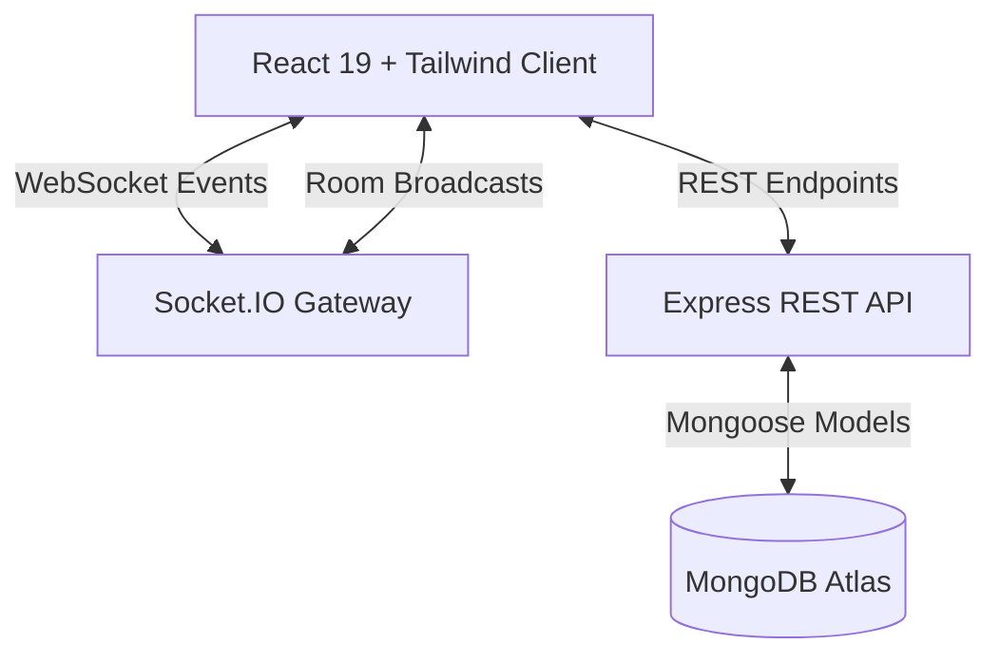

# Nexora Health — Hospital Operations & Bed Management Platform

<p align="center">
  
</p>

<p align="center">
  <strong>An enterprise-grade, real-time hospital management system engineered for high-acuity patient tracking, bed reservation lifecycles, and cross-departmental operations.</strong>
</p>

<p align="center">
  
  
  
  
  
  
  
</p>

---

## 📋 Table of Contents

- [Overview](#-overview)
- [Key Features](#-key-features)
- [System Architecture](#-system-architecture)
- [Role-Based Portals](#-role-based-portals)
- [Technology Stack](#-technology-stack)
- [Getting Started](#-getting-started)
  - [Prerequisites](#prerequisites)
  - [Backend Setup](#backend-setup)
  - [Frontend Setup](#frontend-setup)
- [Demo Credentials](#-demo-credentials)
- [Project Directory Structure](#-project-directory-structure)
- [License](#-license)

---

## 🏥 Overview

**Nexora Health** is a centralized full-stack clinical platform designed to bridge communication gaps between hospital departments. From initial outpatient reception, bed reservation, and specialist physician consultations to diagnostic scan queues, inpatient ward tracking, pharmacy dispensation, and cashier checkout, Nexora provides unified real-time operations across 9 distinct hospital roles.

---

## ✨ Key Features

- **Dynamic Hospital Taxonomy**: Complete hierarchy management — Blocks &rarr; Floors &rarr; Departments &rarr; Wards &rarr; Beds with live occupancy status (`AVAILABLE`, `OCCUPIED`, `RESERVED`, `CLEANING`, `MAINTENANCE`).
- **Interactive Cash Counter Billing Desk**:
  - Full-width patient search with autocomplete and **explicit patient selection cards** (no forced auto-selection).
  - Real-time **Cash Tender & Change Calculator Desk** (Preset tender amounts, real-time change due or remaining calculation).
  - 1-Click bulk settlement and FIFO partial payment handling.
- **Real-Time WebSockets Engine**: Instant data synchronization across all desks using **Socket.IO** (admissions, scan orders, medication queues, bed transfers, and Code Blue emergency broadcasts).
- **Ward Diagnostics Tracking**:
  - Outpatient and inpatient departure tracking with departure timestamps.
  - Live status indicator (`IN DIAGNOSTICS ROOM`) with strict deduplication.
  - 1-click `Confirm Return to Ward` returning bed status back to `OCCUPIED`.
- **Clinical Prescriptions & Diagnostic Orders**:
  - Doctor prescription builder with dosage, duration, and inventory stock availability warnings.
  - Diagnostic scan ordering with priority triage (`ROUTINE` vs `URGENT`).
  - Cross-department doctor referrals with specialized physician routing.
- **Code Blue Emergency Alert System**:
  - Real-time emergency trigger for doctors and nurses.
  - Audible and visual alert broadcasts across the relevant ward staff.
- **Interactive Patient Journey Portal**:
  - Visual 6-step journey map: *Registration &rarr; Consultation &rarr; Diagnostics &rarr; Admission &rarr; Inpatient Stay &rarr; Discharge*.
  - Live ward bed location badge.
  - Compact cards with expandable *Show More / Show Less* toggles for timeline events, appointments, scans, and invoices.

---

## 🏛️ System Architecture



---

## 👥 Role-Based Portals

| Portal | Route | Description |
|---|---|---|
| **System Admin** | `/admin/dashboard` | Executive KPIs, revenue metrics, staff directory, hospital structure builder, and real-time bed controllers. |
| **Reception Desk** | `/reception/dashboard` | Patient registration, fixed-tariff doctor booking, inpatient bed reservation, and checkout cashier desk. |
| **Physician / Doctor** | `/doctor/dashboard` | Consultation queue, clinical notes, diagnosis, e-prescriptions, diagnostic ordering, referrals, and Code Blue alerts. |
| **Nurse Station** | `/nurse/dashboard` | Inpatient monitoring, vital signs logging (BP, Pulse, SpO2, Temp), medication administration, and alert resolution. |
| **Ward Staff** | `/ward/dashboard` | Bed directory, inpatient stay board, ward transfer management, and diagnostics departure tracking. |
| **Diagnostics / Labs** | `/diagnostics/dashboard` | Radiology, pathology, cardiology, and ultrasound queues; check-in verification and scan report submissions. |
| **Pharmacy Counter** | `/pharmacy/dashboard` | Prescription verification queue, billing payment checks, medication dispensation, and stock reconciliation. |
| **Cashier / Billing** | `/billing/dashboard` | Central hospital cash counter, patient search with multi-match choices, cash tender calculator, and history ledgers. |
| **Patient Portal** | `/patient/dashboard` | Self-service journey stepper, assigned bed badge, consultation history, e-prescriptions, and outstanding invoices. |

---

## 🛠️ Technology Stack

### Frontend
- **Framework**: React 19 with TypeScript
- **Build Tool**: Vite 8
- **Styling**: Tailwind CSS & Vanilla CSS Design Tokens
- **Icons**: Lucide React
- **Networking**: Axios & Socket.IO Client

### Backend
- **Runtime**: Node.js 18+
- **Framework**: Express.js with TypeScript (`ts-node-dev`)
- **Database**: MongoDB with Mongoose ODM
- **Real-Time**: Socket.IO
- **Security**: JSON Web Tokens (JWT), bcryptjs password hashing, CORS, input sanitization

---

## 🚀 Getting Started

### Prerequisites
- [Node.js](https://nodejs.org/) (version 18 or higher)
- [MongoDB](https://www.mongodb.com/) (Local installation or MongoDB Atlas URI)
- Git

---

### Backend Setup

1. Open a terminal and navigate to the backend directory:
   ```bash
   cd backend
   ```

2. Install dependencies:
   ```bash
   npm install
   ```

3. Create your environment file from the example template:
   ```bash
   cp .env.example .env
   ```

4. Configure your `.env` variables:
   ```env
   PORT=5000
   MONGODB_URI=your_mongodb_connection_string
   JWT_SECRET=your_super_secret_jwt_key
   FRONTEND_URL=http://localhost:5173
   ```

5. Seed the database with initial departments, wards, beds, medicines, and staff accounts:
   ```bash
   npm run seed
   ```

6. Start the backend development server:
   ```bash
   npm run dev
   ```
   *The backend will start on `http://localhost:5000`.*

---

### Frontend Setup

1. Open a second terminal and navigate to the frontend directory:
   ```bash
   cd frontend
   ```

2. Install dependencies:
   ```bash
   npm install
   ```

3. Start the Vite development server:
   ```bash
   npm run dev
   ```
   *The frontend will run at `http://localhost:5173`.*

---

## 🔑 Demo Credentials

All test accounts are pre-seeded and ready for immediate evaluation:

| Role | Username | Password | Notes / Specialty |
|---|---|---|---|
| **System Admin** | `admin` | `admin123` | Full hospital configuration & KPIs |
| **Receptionist** | `reception` | `reception123` | Patient check-in & bed reservations |
| **Doctor (Internal Medicine)** | `doctor1` | `doctor123` | Dr. John Smith |
| **Doctor (Cardiology)** | `doctor2` | `doctor123` | Dr. Sarah Connor |
| **Doctor (Orthopedics)** | `doctor3` | `doctor123` | Dr. David Tennant |
| **Staff Nurse** | `nurse` | `nurse123` | Inpatient vitals & care |
| **Ward Staff** | `ward` | `ward123` | Ward bed stays & diagnostics tracking |
| **Diagnostics Officer** | `diagnostics` | `diagnostics123` | All diagnostic & lab scan queues |
| **Pharmacist** | `pharmacy` | `pharmacy123` | Charlie Brown (Dispensary) |
| **Cashier / Billing Officer** | `billing` | `billing123` | Diana Prince (Cash Desk) |
| **Patient** | `P1001` | `12051990` | John Doe (DOB: 12/05/1990) |

---

## 📁 Project Directory Structure

```text
Nexora-Health/
├── backend/
│   ├── src/
│   │   ├── config/          # Socket.IO & database setup
│   │   ├── controllers/     # Modular business logic
│   │   ├── middleware/      # Auth & RBAC role guards
│   │   ├── models/          # Mongoose schema definitions
│   │   ├── routes/          # REST endpoints
│   │   ├── scripts/         # Database seeding utilities
│   │   └── index.ts         # Main HTTP & WebSocket server entry
│   ├── .env.example         # Environment template
│   ├── package.json
│   └── tsconfig.json
├── frontend/
│   ├── public/              # Static SVG assets & icons
│   ├── src/
│   │   ├── assets/          # Logos & visual branding
│   │   ├── components/      # Shared layout, navigation, & modal components
│   │   ├── context/         # AuthContext & SocketContext providers
│   │   ├── pages/           # 9 Role-based operational dashboards
│   │   ├── services/        # Centralized HTTP request helper
│   │   ├── App.tsx          # Client-side protected routing
│   │   ├── index.css        # Custom CSS tokens & animation classes
│   │   └── main.tsx         # React root entry point
│   ├── package.json
│   ├── tailwind.config.js   # Custom healthcare theme tokens
│   └── vite.config.ts
├── .gitignore               # Root git ignore rules
└── README.md                # Project documentation
```

---

## 📄 License

This project was developed as an S5 Mini Project prototype for modern digital healthcare infrastructure. Distributed under the MIT License.
